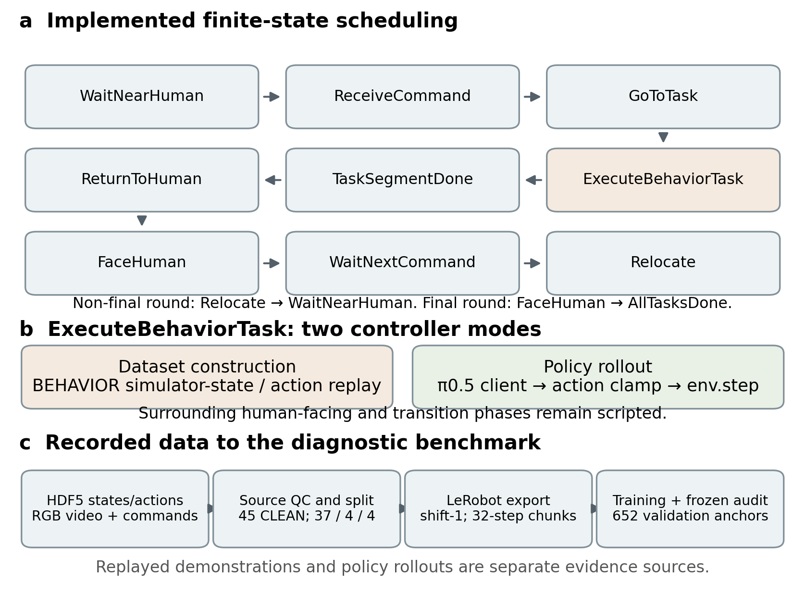

# Long-horizon HRC dataset and diagnostic benchmark

This research release records the construction, implementation and evaluation of a human–robot collaboration (HRC) case study built around BEHAVIOR-1K / OmniGibson. It preserves source provenance and the frozen evidence used by the MSc dissertation. The learned π0.5 policy is a case study within a scripted collaborative system; this repository does not introduce a new foundation model.

The final manuscript studies a hierarchical diagnostic benchmark on 45 retained simulation sources: supervision construction, behavioural baselines, matched inference noise, observation conditioning, and separate historical closed-loop diagnostics. The benchmark includes the source split, frozen anchors, metrics, baselines and reproducibility checks in addition to the trajectory dataset.

## Release scope

The copyright holder explicitly authorized this dissertation and the private `lucaswhd/dissertation` repository on 19 October 2026. Original copyright and third-party notices are preserved; no blanket license is assigned to all repository contents. See [publication scope](source_snapshots/PUBLICATION_SCOPE.md) and [third-party software](docs/THIRD_PARTY_SOFTWARE.md).

Full datasets, videos, scene/human assets, model weights, environments, caches, raw experiment logs, and the manuscript DOCX are excluded. The task storyboard and its extracted frames remain local pending confirmation of the underlying asset/render redistribution terms. Its generation script and frame manifest are included. Numeric summaries and non-video figure assets are included.

## Implementation and architecture

The implemented scheduler is:

`WaitNearHuman → ReceiveCommand → GoToTask → ExecuteBehaviorTask → TaskSegmentDone → ReturnToHuman → FaceHuman`.

A non-final round continues through `WaitNextCommand → Relocate → WaitNearHuman`; the final round exits through `AllTasksDone`. Transitions are controlled by the scripted scheduler, not selected by the learned policy. During dataset construction, manipulation replays upstream simulator-state/action trajectories. In policy rollout, a policy client provides real actions inside `ExecuteBehaviorTask`; the surrounding phases and online navigation remain scripted. Recorded phase labels also enter the policy prompt.



Three source trees have distinct roles:

| Snapshot | Role |
|---|---|
| `source_snapshots/hrc_pipeline/` | Historical collection code. |
| `source_snapshots/hrc_pipeline_traintest/` | Final research collection, online navigation, processing and rollout integration. |
| `source_snapshots/openpi_hrc/` | Research additions/modifications relative to a specified local OpenPI baseline; includes a restoration patch. |

Imports and relative layouts are preserved within each tree. These are audited source snapshots, **not three independently installable packages**. Follow [source restoration instructions](docs/SOURCE_LAYOUT.md); do not move modules solely to match an aesthetic directory layout.

## Installation and dependencies

The simulator environment observed locally contains Python 3.10.12, OmniGibson 3.7.2, BDDL 3.7.0 and Isaac Sim 4.5.0.0. Earlier README/environment claims differ; see [dependency audit](reports/DEPENDENCY_AUDIT.md). Software and dataset assets must be obtained under their own terms. Installing or running the complete simulator stack was not repeated in this release.

For the analysis utilities, use a separate Python environment:

```bash
python -m venv .analysis-venv
. .analysis-venv/bin/activate
python -m pip install -r environment/analysis-requirements.txt
```

`ffmpeg` and `ffprobe` are additionally required for video metadata and exact-frame extraction. Parquet-based independent checks require `pyarrow`; the existing OpenPI environment was used for those checks. The dependency file records the versions used for the new plotting/DOCX work rather than a complete training lockfile.

## Dataset preparation and schema

The final continuous dataset is built from `hrc_batch_rerun_v1`, not from the older ACT canonical export. Source-level quality control retained 45 of 65 executions: 45 CLEAN, 19 REJECT and one excluded TRIM. The frozen split is 37 train / 4 validation / 4 test sources, totalling 409,670 recorded frames at 30 Hz.

The active observation is head RGB (352×256 before model preprocessing), together with 23 physical state dimensions and a task/phase prompt. Wrist-image slots are masked placeholders. The physical action has 23 dimensions; the model interface pads to 32. Supervision pairs observation `t` with `raw_action[t+1]`. The 32-step target must remain within one source and coarse context; each source's final repeated-action sentinel is invalid for training.

The A and B/C exports preserve identical physical state/action rows; B/C changes local instructions, decision labels and valid-anchor masks. The B manifest retains some inherited A anchor counts: use actual parquet masks or the validated export summaries. See [dataset audit](reports/DATASET_AUDIT.md) and [dataset manifest](docs/DATASET_MANIFEST.md).

```bash
python tools/plotting/audit_dataset.py --data-root /path/to/local-data-root --out tables
```

The full HDF5/LeRobot conversion requires the original assets and the matching research environment. Historical helper scripts may write annotations back to the source HDF5; inspect their documented side effects and use expendable input copies rather than the only original.

## Training

The main A20/B20/C20 comparison uses one 20,000-update run per configuration, training seed 42. A→B changes prompt granularity and sampling together. B→C changes state and action normalization together. These are not isolated prompt-only or action-only ablations.

Training entry points and HRC configurations are preserved in the OpenPI snapshot/patch. The final setup uses π0.5 LoRA variants, a frozen visual tower, effective batch size 8 and horizon 32. Archived optimization curves are available under `tables/training_curves.csv`; they are normalized flow objectives, not task-success or common-scale physical-error curves. Full training was not rerun. B20 and C20 checkpoints are currently absent locally; saved predictions and logs remain available.

## Evaluation and actual findings

The final teacher-forced audit uses 652 matched validation anchors from four sources and inference flow-noise seeds 0–4. These seeds describe inference variability, not independent training runs. Pickup arm skill relative to no motion is approximately −0.0107 / 0.0122 / 0.0144 for A20/B20/C20. Pickup gripper-event F1 is approximately 0.1120 / 0.3358 / 0.3825. Higher event F1 does not establish successful grasping. A base-persistence rule exceeds the learned base predictors in the relevant contexts.

The separate conditioning probe has 108 validation anchors (96 pickup, 12 radio) and 216 training-coverage anchors. Anchor-bootstrap intervals describe these frozen anchors. Historical rollout failures are documented separately and do not support an A/B/C success-rate ranking. See [experiment audit](reports/EXPERIMENT_AUDIT.md) and [experiment index](docs/EXPERIMENT_INDEX.md).

Independent archive rescoring checked 9,780 saved prediction chunks against exported truth with zero discrepancy in the checked metrics. Full export alignment checked both A/B exports against all 409,670 raw rows. Model inference, training and simulator replay were **Not independently verified** in this release.

## Reproducing dissertation figures

Four non-video figure families can be regenerated using only included numeric tables:

```bash
python tools/plotting/generate_figures.py --from-release-tables
```

With the private local datasets/videos also present:

```bash
python tools/plotting/generate_figures.py --data-root /path/to/local-data-root
python tools/plotting/build_tables.py --data-root /path/to/local-data-root
python tools/plotting/update_dissertation.py --input /path/to/original.docx --output /path/to/separate-v7.docx
```

The Word script targets the supplied 836-paragraph v6 manuscript. It preserves the input, restores 18 native tables, adds three methodology/dataset figures plus an appendix training figure, sets A4, and replaces stale front-matter indexes with updateable Word fields. Other manuscript revisions require adapting the anchors. This describes the historical v7 build. The v8 revision below supplies an actual LibreOffice-rendered and reviewed PDF; the original v7 receipt is preserved.

The task storyboard remains a local output and will be recreated only when videos are available. Use [figure plan](reports/FIGURE_IMPROVEMENT_PLAN.md), [figure traceability](reports/FIGURE_TRACEABILITY.md) and `tables/figure_to_thesis_mapping.json` for captions and exact insertion anchors.

## Repository structure

| Directory | Contents |
|---|---|
| `source_snapshots/` | Audited historical/final source trees and OpenPI restoration patch. |
| `tools/` | Inventory, figure and Word generation utilities. |
| `figures/` | Reproducible non-video methodology, dataset and training figures. |
| `tables/` | Actual dataset statistics, curve records, native-table payload and figure mapping. |
| `evidence/` | Selected frozen numeric summaries and anchor manifest. |
| `reports/` | Project, dependency, dataset, experiment, figure, safety and release audits. |
| `docs/` | Source restoration, third-party notices and resource/experiment indexes. |
| `environment/` | Observed analysis dependencies; simulator details are separate. |

## Reproducibility limits and attribution

Local source snapshots preserve original notices. OmniGibson/BEHAVIOR replay, robot/environment capabilities, OpenPI and pretrained π0.5 components are upstream contributions. Project contributions concern HRC orchestration/integration, dataset construction/annotation, protocol construction and diagnostic evaluation. Human participants were not newly recruited for these simulated HRC executions; the virtual human is scripted, while upstream manipulation demonstrations originated from teleoperation.

No full model training, inference or simulator rollout was rerun. Missing B/C weights, inherited B manifest counts, unresolved asset redistribution scope and Microsoft Word cross-engine pagination differences are recorded, rather than silently treated as solved. Citation metadata for a public dataset/repository release has not been minted; use the actual dissertation bibliographic record and upstream project citations when available.

Start with the [Chinese final release report](reports/FINAL_RELEASE_REPORT.md).


## Dissertation v8 revision

The v8 local manuscript has11 figures,18 unchanged native tables and12 restored native Word equations. Image line spacing, figure/caption pagination, indexes, table breaks and chapter page numbering were repaired. A real78-page review PDF was rendered with LibreOffice Writer **and Math**, then all pages were reviewed. See [v8 delivery report](reports/V8_FINAL_DELIVERY_REPORT.md), [visual QA](reports/V8_VISUAL_QA.md) and [traceability](reports/V8_FIGURE_TRACEABILITY.md).

Reproduce the safe new/revised graphics from included evidence:

```bash
python tools/plotting/generate_v8_methodology.py
python tools/plotting/generate_v8_evidence.py --from-tables
python tools/plotting/generate_v8_frustum.py
```

Figure3.6 uses real segment, per-source action and valid-mask statistics. The event profile is Figure5.3 in the manuscript, followed by conditioning Figure5.4, to follow first appearance; its asset stem retains the requested5.4. Error bars represent five inference-noise seeds, not training seeds. Figure5.1 is redrawn from exactly the archived validation counts.

The local-only v7 manuscript and six verified frames are needed for Word rebuilding:

```bash
python tools/plotting/generate_v8_storyboard.py --frames /path/to/verified/frames
python tools/plotting/update_dissertation_v8.py --input /path/to/v7.docx --output /path/to/v8_source.docx --event-number 5.3
/usr/bin/python3 tools/plotting/render_v8_document.py --input /path/to/v8_source.docx --pdf /path/to/v8_review.pdf --updated-docx /path/to/v8_editable.docx
python tools/plotting/validate_v8_docx.py /path/to/v8_editable.docx --expect-pass
OMP_NUM_THREADS=1 /usr/bin/python3 tools/plotting/qa_v8_pdf.py --pdf /path/to/v8_review.pdf --out /path/to/private-qa
```

Analysis uses Python3.12, matplotlib, numpy, Pillow, h5py and python-docx1.2/lxml; rendering uses system Python3.10, python3-uno, python3-fitz, python3-pil, LibreOffice Writer+Math7.3.7.2, Poppler and Liberation/DejaVu/STIX fonts. These are observed versions, not a simulator lockfile. No training environment was changed. The Math component is required: omitting it can silently blank native equations in exported PDF.

Full DOCX/PDF, real simulation frames, all-page previews and the detailed v7 diff stay in the controlled local delivery because upstream scene/human-render redistribution permission is unconfirmed. The private repository contains safe numerical/diagram assets, code, metadata and reports. The exact latest applicable EEE declaration remains **Pending official template verification**; real AI disclosure and unsigned placeholders are preserved.
