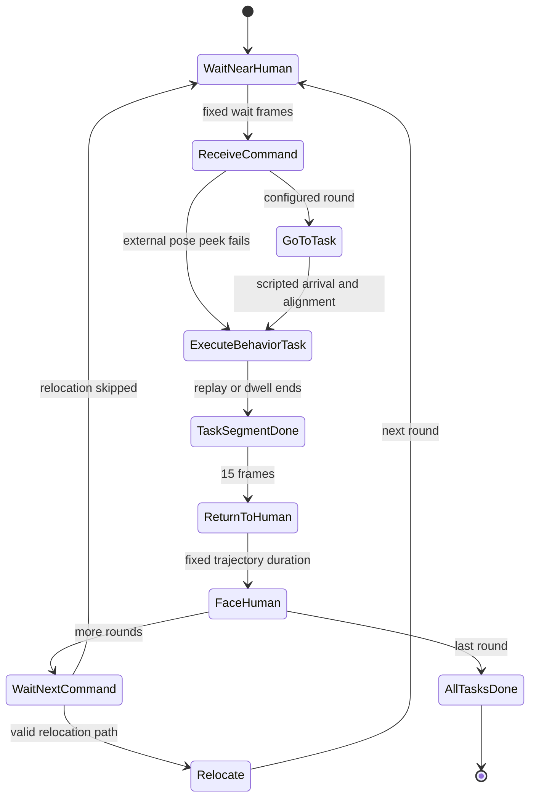

# HRC 核心工程只读审计

审计日期：2026-10-19（Asia/Singapore；对应host的2026-10-18 UTC）。范围：`/root/hrc_pipeline` 的原创候选脚本、配置、记录器、人物转换桥、嵌套 OmniGibson 的版本及许可证；读取相邻 behavior-venv 的安装元数据。没有运行仿真、训练、采集、下载或 git 网络操作，没有修改原项目或源数据。下述行号均相对审计时源文件，不是发布副本。静态风险不是已复现故障。

> **版本边界：第1–6节审计的是`/root/hrc_pipeline`旧采集主树，不是最终研究实现。研究分支已实现在线物理导航和policy injection，见第7节。不能将旧树的局限不加区分地写成最终系统结论。**

## 1. 可以据实写进论文的系统定位

当前核心实现是**基于既有 BEHAVIOR 示教状态回放，叠加人类角色、脚本导航、交互阶段标签、相机和多模态记录的 HRC 数据构建流水线**。`scripts/hrc_multitask_demo.py:2252` 的轮次循环按配置依次调用阶段函数。没有在这个主入口中发现从 RGB/语言推断动作的学习策略调用。

- Task execution：`replay_segment` / `replay_external_segment` 从 HDF5 逐帧恢复仿真状态并送入记录动作；分别见 `scripts/hrc_utils.py:519–569`、`612–639`。奖励及终止标签由**源记录**写回 info（525–527、562–564、629–631），不能当作新策略在线成功率。
- Scripted navigation：A* 和地图/物体 AABB 提供参考路径，机器人 base 直接 `set_position_orientation`，再 `env.step(zero_action)`，见 `scripts/hrc_multitask_demo.py:941–1015`、`1061–1089`。这是运动学轨迹合成，不是由记录 action 单独驱动的可执行导航策略。
- Scripted radio：关节姿态直接写入，峰值帧直接 `radio_obj.states[ToggledOn].set_value(True)`，见 `scripts/hrc_multitask_demo.py:1597–1713`，尤其1680、1686、1702。不能称作学习策略通过接触操纵开关。
- Policy learning/evaluation：核心采集目录不能证明训练或闭环结果；相关代码与实验属于另一区域，需要独立证据链。配置名含 `closed_loop` 也不等于真实策略评估。

## 2. 核心模块与边界

| 文件 | 已实现职责 | 关键证据 |
|---|---|---|
| `scripts/hrc_multitask_demo.py` | 逐轮指令、任务分支、A* 衔接、回到人类、轮间迁移、动态相机 | 2252–2526；1018–1225；2050–2105 |
| `scripts/hrc_minimal_demo.py` | DemoRecorder；视频、NPZ、JSON、合并HDF5、兼容源文件补注 | 45–451 |
| `scripts/hrc_utils.py` | 状态ID、回放环境、源回放、外部回放、几何可见性、读人物轨迹 | 52–85；430–640；679–788 |
| `scripts/hrc_humanoid.py` | 运动学人类、动画、出生点搜索、地图路径、粗碰撞代理 | 64–118；183起；590–776；1573–1681；2048–2078 |
| `scripts/habitat_humanoid_bridge.py` | Habitat GLB/URDF/动作数据到USD与运行时动画元数据的转换器 | 98–105；127–393 |
| `scripts/collect_hrc_data.py` | 较早单轮采集：初始等待→命令→回放→返回→等待 | 220–250 |
| `scripts/batch_collect_hrc.py` | 早期单轮批处理，每episode子进程 | 18–51 |
| `scripts/run_collection_AB.py` | 配对/固定base采样、独立进程、超时重试、进度续跑 | 112–185；261–331；355–443 |
| `scripts/hrc_final_return_only.py` | 只渲染最终返回的调试工具，不是独立benchmark | 4–8 |
| `patches/data_wrapper.patch` | 上游HDF5只读句柄改为读写句柄的两处差异 | 1–22 |

原项目自身 `scripts/*.py` 共20个、10,514行（物理行数，不等于原创净行数）。嵌套 OmniGibson 是独立第三方仓库，不计入原创贡献。

## 3. 真实FSM及转移表

状态字典 `scripts/hrc_utils.py:52–63` 给出10个标签。这里的FSM是**过程调度与注释状态机**：不含感知置信度门控，不等待真实语音输入，不按task_success触发正常阶段转移。`ReceiveCommand` 的文本来自配置；`recorder.add_command` 记下命令（`hrc_multitask_demo.py:2261–2267`），阶段按固定帧数运行。

| ID | 当前状态 | 实际结束条件/动作 | 下一状态 | 源码位置 |
|---:|---|---|---|---|
| 0 | WaitNearHuman | 先有1.5×fps的初始化等待；每轮再等待wait_steps | ReceiveCommand | multitask:2233–2246、2266–2267 |
| 1 | ReceiveCommand | 固定wait_steps结束；无ASR/指令识别门控 | GoToTask；外部peek失败时可直接执行 | multitask:2267、2313–2326 |
| 2 | GoToTask | 到录制起点的预设步数轨迹，再以同标签旋转对齐；scripted_radio到radio接近点 | ExecuteBehaviorTask | multitask:2280–2297、2318–2324、2413–2420 |
| 3 | ExecuteBehaviorTask | scripted_radio dwell结束；base回放到片段边界/最大步数/源终止；external到边界/最大步数 | TaskSegmentDone | utils:530–569、609–640；multitask:2479–2480 |
| 4 | TaskSegmentDone | 固定15帧 | ReturnToHuman | multitask:2480–2484 |
| 5 | ReturnToHuman | 预设return_steps路径插值结束 | FaceHuman | multitask:1171–1195、2482–2486 |
| 6 | FaceHuman | 预设face_human_steps旋转结束 | WaitNextCommand（非末轮）/AllTasksDone（末轮） | multitask:1198–1225、2488–2490 |
| 7 | WaitNextCommand | 固定wait_steps；若迁移找到可行路径则进入Relocate | Relocate或下一轮WaitNearHuman | multitask:2490–2526 |
| 9 | Relocate | 按路径长度/walk_speed×fps算帧数；无目标/路径太短会跳过 | 下一轮WaitNearHuman | multitask:1290–1291、1430–1443、1509、2252–2267 |
| 8 | AllTasksDone | 固定wait_steps后close记录器 | 结束 | multitask:2489–2490、2532 |

执行状态内部有三种**配置分支**（multitask:2279、2301、2388），不是三个新FSM标签。发生异常会抛出并shutdown（2544–2549）；没有实现Recovery/AskClarification/RetryTask等正常状态，图中不应凭空添加。

## 4. 人物、相机和观测的准确含义

人物外观来自 Habitat male_0 转换派生资产：`assets/source_asset.json:2–8` 记录layout=6、bridge=15和来源GLB/URDF/SMPL-X动作路径。转换器代码与转换后网格、骨骼、纹理、动作数据的权利应分开处理。

`KinematicHumanoidActor` 提供hold/walk/turn三个运动标签（`hrc_humanoid.py:35–39`），按阶段配置运动（multitask:1732–1753）。正常step按waypoint模式更新yaw/xy、动画、gait和USD（humanoid:1957–2022、2048–2078）。它不是学习的人类行为生成器。执行期若找到已记录人轨迹则按progress索引重采样（utils:712–788），同时每帧回放load后重同步（multitask:2368–2375、2449–2456）；否则按阶段hold，且可触发程序化dodge。轮间迁移显式设人、机器人位姿（multitask:1491–1509）。

头部RGB通过名称优先级选取（utils:139–154）。第三人称相机位于人机中点侧向位置并做EMA平滑（utils:214–241）。头相机可调pitch、aperture，按阶段目标pitch做平滑（multitask:235–306、309–398、2059–2077）。每帧相机local/world pose和pitch进入合并HDF5（minimal:310–314），内参与配置在attrs（multitask:2086–2105）。这支持分析相机调度，却不自动证明像素与外参毫秒级同步。

`relative_human_pose` 实际只是**世界坐标位置差**human_pos−robot_pos（utils:261–264），不是机器人局部坐标下完整6D相对姿态。`human_visible_flag` 是基于机器人base yaw的二维夹角≤42.5°且距离≤3m的启发式（utils:267–276），不考虑相机pitch、真实内参、遮挡或可见像素比例。

## 5. 记录格式与静态审计发现

主记录器写head/third视频、`data/trajectories.npz`、`annotations/commands.json`、`meta/episode_meta.json`、`hrc_dataset.hdf5`。HDF5按round_id分`data/demo_N`，obs字段15个，top字段6个（minimal:299–339）；RGB本身在视频中，合并HDF5没有RGB数组、完整仿真state或state_size。仅拿合并HDF5不能声称能完整重建原仿真场景；还需要原始录制、模型资产、版本和相机/视频映射。

| 优先级 | 静态发现 | 直接证据与影响 |
|---|---|---|
| 高 | 记录器会尝试修改输入原始HDF5 | minimal:283–291调legacy；428–436以a模式打开并删除/重建`data/hrc`。严禁在唯一原始文件上直接重跑；本次未调用这些函数。发布说明须明示副作用。 |
| 高 | 源补注writer与人物loader路径不一致 | writer为`data/hrc/round_N`（minimal:434–439）；loader找`hrc/round_N`（utils:695–703）。单靠此writer产物不能被该loader找回。未改源码。 |
| 高 | task_success语义不是完整任务成功，也不是注释所说的累计成功 | minimal:168–177每帧局部重置，以done.success或reward>0赋1；源reward可为子目标。多任务main不会用该字段门控返回（2479–2490）。 |
| 高 | 逐demo指令可能全部被最后一轮覆盖 | minimal:345于close时给每demo写当前self.instruction；multitask:2262每轮覆盖该属性。commands.json有逐轮指令可供核对。activity同理为记录器级字段。 |
| 中 | external无限定end_step时已记录人物轨迹进度分母异常 | multitask:2348–2349把未设end转换为10**9，2370用作progress分母；与实际回放长度不等。存在轨迹时可能几乎停留首帧。 |
| 中 | 头相机RGB与外参有时序偏移风险，尚未动态验证 | env.step产生obs后进入record；record:109–121先改相机，135从传入obs提RGB，194–196再读当前外参。渲染可刷新viewer，但没有显式重新取head obs。不能仅据注释断言完美同步。 |
| 中 | 回放action与state是否存在一帧偏移须单独校验 | 本地utils:550–561加载state[next_i]并用action[next_i]；上游data_wrapper:1025–1026对应action与state[1:]配对。不能假设其动作监督严格对齐。 |
| 中 | 外部回放不重建源记录的systems/objects transitions，也不在源终止时break | 对比utils:612–640与base:534–548、568–569。跨任务拼接依赖对象重叠和预先补齐，不能保证所有外部任务通用。 |
| 中 | collision-free不是严格全程保证 | humanoid:700–716逐级放宽，tier2只测footprint、tier3单点、723–736可raw fallback；路径1573–1603亦有直线fallback。论文应称启发式避障/候选检查，而非无碰撞证明。 |
| 中 | 轮间迁移帧数没有使用total_steps硬上限 | multitask:1443按路径速度算walk_frames，1464循环。配置relocate_steps不能直接当实际帧数。 |
| 中 | batch的done只证明产物结构最低限 | run_collection_AB:89–105只检查至少1个demo，179–185检查返回码/产物；这不是任务成功评估。 |
| 低 | 演示SUCCESS日志不是策略成功结论 | multitask:2535无条件打印流程完成，下方2538–2540才列各轮stats。 |

## 6. 发布候选与应排除内容

建议只导出原创候选的` scripts/`（20个py）、`configs/`（5个yaml）、原创部署/运行脚本、`patches/data_wrapper.patch`和经审查的文档；核心应优先保留multitask/minimal/utils/humanoid/bridge/collect/batch/run_collection。诊断工具以tools/debug分类介绍也可，不应作为完成的学习实验。

不发布：整个嵌套`OmniGibson/`树、第三方训练仓库/虚拟环境、下载资产和原始示教、`assets/`的全部模型/纹理/动画派生文件、outputs中的HDF5/NPZ/视频、缓存、日志、临时Notion导出、编辑器设置、凭证与任何受限数据。`assets/source_asset.json`含他人机器绝对路径且记录受限资产来源，应改成文档中的去标识来源说明，不直接复制。

源码目前根LICENSE和文件头都是All Rights Reserved（LICENSE:1–23），且明文要求论文使用和分发获得版权方书面同意。用户现已明确确认本人是权利人，并授权用于本论文及指定仓库；该范围内原创代码权属阻碍已解除，可在最终安全审查后准备上传。保留原版权与LICENSE，不重许可。该授权不覆盖第三方资产、人物动作、模型权重或原始示教数据。`hrc_utils.py`回放逻辑与Stanford上游高度对应，应作为上游适配段保留MIT声明，不能整体标作从零原创。详见DEPENDENCY_AUDIT.md与docs/THIRD_PARTY_SOFTWARE.md。

## 7. 追加核对：当前研究分支的在线导航和policy injection

主代理另指定`/root/autodl-tmp/hrc_pipeline_traintest/scripts/collection/hrc_multitask_demo.py`，本节所有multitask行号仅指此研究分支；commit为`6980ad469c775a4da508dbdccc8465ab9b1df1e5`，工作区是否完全等同commit须结合主代理的状态/manifest。以下为接口静态核对，没有运行仿真。

**该分支确实存在在线物理导航，不能把旧树的直接位姿设置概括为最终实现。**`--online-nav`定义于4390–4395；contacts-ON wrapper构建于4531–4543；OnlineNavDriver于5058–5061构造；`_walk_robot_along_path`在2293分流，2324–2338调用drive_path_smooth/drive_along_path并记录真实动作。FaceHuman也有物理旋转路径（2562–2574）。因此“scripted FSM”可描述高层阶段调度，“在线物理导航”描述启用online-nav后的低层执行，两者兼容。未启用该开关时仍存在旧运动学fallback（2368–2376），不能把所有运行默认称为物理闭环。操纵示教回放在采集模式仍load_state，开关注释4395已明确。

**该分支也存在学习策略在线注入。**`--policy-rollout`定义4398–4401，4434–4435使其蕴含online_nav；policy客户端连接/reset在5083–5096。`_policy_step`（812–868）从head RGB、关节/夹爪及前一动作构建23维state（828–838），调用client.act(state,head,task,phase)（839–844），夹限动作（848–852），经env.step(action)执行（857）并记录live reward/done（860–867）。GoToTask、ReturnToHuman、FaceHuman分别于2384、2485、2550进入policy分支；Relocate机器人动作经policy执行（3525–3552），human仍走预设路径。Execute分支在5359–5389和5510起用policy逐步执行，else才做源录制回放（5390起、5542起）。单凭接口存在不证明训练质量或任务成功率，但可以据实写“已实现policy rollout接口”。

`Pi05PolicyClient.act`（`scripts/evaluation/pi05_policy_client.py:157–204`）验证state=(23,)和HWC RGB，context变化重置动作缓存，明确把Task与**oracle Phase**拼入prompt（191）。因此这种评估有scripted阶段编排，不是模型自主预测高层FSM；phase输入不能在对比中隐去。32步chunk/8步执行来自该client:16–18及185–188的接口声明，实际服务端/检查点需另证。

该分支状态ID仍为`collection/hrc_utils.py:52–63`的10标签。精确调度为：初始化Wait（5197–5199）；每轮WaitNearHuman（5221）→ReceiveCommand（5222）→GoToTask→ExecuteBehaviorTask→TaskSegmentDone（5574）→ReturnToHuman（5576）→FaceHuman（5579）→WaitNextCommand/AllTasksDone（5583–5584）；非末轮Relocate（5610–5625）后for继续（5206），会再次经过WaitNearHuman（5221）再ReceiveCommand（5222）。若图将Relocate直接连ReceiveCommand，须注明省略短Wait；严格代码图应连WaitNearHuman。

该分支新增轮末`success_predicate`评估（5562–5571），与旧树“仅正reward代理”的结论不同；然而无论谓词成功失败都会继续TaskSegmentDone/Return（5573起），因此转移箭头仍应写“阶段预算/执行结束”，不能写“已成功才返回”。

发布状态更新：权利人已授权论文及指定仓库使用原创代码；本地storyboard与Word渲染材料继续仅本地保留，素材条款未单独确认。第三方资产、human motion、模型权重与原始数据不入代码发布。
